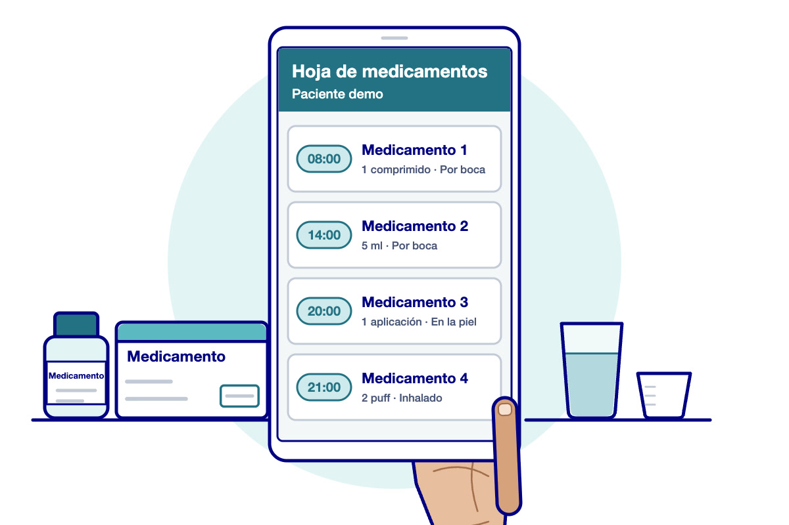

::: {.box .esencial}
[Lo esencial]{.etiqueta}

- Antes de cada dosis, **revisa la hoja de medicamentos en RegisCare**. Lo que no está en la hoja, **no se da**.
- Si algo no coincide con la hoja (el medicamento, la dosis, el envase), **no lo des y avisa** al equipo.
- Prepara **una dosis a la vez**, desde su **envase original**, justo antes de darla.
- **Registra después de dar** el medicamento, nunca antes.
- Si olvidaste una dosis, **no des el doble**. Si te equivocaste, **avisa de inmediato**: nunca lo ocultes.
- Ante una **emergencia, llama al 131**. ProSalCare no es un servicio de urgencia.
:::

<video class="modulo-vid" controls playsinline preload="metadata" poster="../assets/media/medicamentos/video-modulo.jpg">
<source src="../assets/media/medicamentos/video-modulo.mp4" type="video/mp4">
<track kind="subtitles" srclang="es" label="Español" src="../assets/media/medicamentos/video-modulo.vtt" default>
</video>

[Video del módulo: 5 minutos, con subtítulos.]{.etiqueta}

## La hoja de medicamentos manda

{fig-alt="Un teléfono con una lista titulada Hoja de medicamentos, con filas genéricas de medicamento, dosis, vía y hora" width="520"}

La hoja de medicamentos es la lista vigente de lo que toma la persona: nombre, dosis, vía, horario y observaciones. No es un papel: **está en RegisCare**, en tu vista de cuidador. La mantiene al día tu enfermera o enfermero, según lo que indica el médico tratante.

- Revísala **antes de cada dosis**. Ningún medicamento se da de memoria ni por costumbre.
- Si hay una **receta o indicación nueva** (un control médico, un alta del hospital), avisa al equipo **antes** de dar la primera dosis, para que la ingresen a la hoja.

## Antes de dar: siete cosas correctas

| | Revisa que… |
|---|---|
| **1. La persona** | La dosis es para ella y corresponde a su hoja de medicamentos |
| **2. El medicamento** | El nombre del envase es el mismo que el de la hoja. Cuidado con los nombres parecidos |
| **3. La dosis** | La cantidad que preparaste es la que dice la hoja |
| **4. La vía** | Se da por donde dice la hoja (por boca, en la piel, inhalado…) y tienes lo necesario |
| **5. La hora** | Es el horario que indica la hoja |
| **6. El registro** | Tienes RegisCare a mano para anotarlo apenas termines |
| **7. El efecto** | Sabes para qué es y qué señales debes vigilar |

## Cuándo no dar un medicamento

::: {.box .nunca}
No lo des, y avisa al equipo, si:

- **No está en la hoja** de medicamentos, o algo no coincide con ella.
- El envase está **vencido, dañado o mal conservado**.
- La persona **no puede tragar bien** o está **muy adormilada o confundida**, y el medicamento es por boca.
- Tiene una **alergia** conocida a ese medicamento.
- La persona **no quiere tomarlo**. No se lo des: anótalo y avisa.
:::

## Preparar la dosis

<ol class="pasos">
<li>**Lávate las manos**, como en el módulo de lavado de manos.<video class="paso-vid" src="../assets/media/medicamentos/preparar-01.mp4" poster="../assets/media/medicamentos/preparar-01.jpg" loop muted playsinline preload="none" aria-label="Manos frotándose con jabón"></video></li>
<li>Usa una **superficie limpia y con buena luz**.<video class="paso-vid" src="../assets/media/medicamentos/preparar-02.mp4" poster="../assets/media/medicamentos/preparar-02.jpg" loop muted playsinline preload="none" aria-label="Una lámpara ilumina una mesa despejada y limpia"></video></li>
<li>**Revisa el envase**: nombre, dosis, vía, fecha de vencimiento y que esté en buen estado.<video class="paso-vid" src="../assets/media/medicamentos/preparar-03.mp4" poster="../assets/media/medicamentos/preparar-03.jpg" loop muted playsinline preload="none" aria-label="Una mano sostiene la caja y se revisan nombre, dosis, vía y vencimiento"></video></li>
<li>**Lee la etiqueta completa** antes de sacar nada. Si puedes, en voz alta.<video class="paso-vid" src="../assets/media/medicamentos/preparar-04.mp4" poster="../assets/media/medicamentos/preparar-04.jpg" loop muted playsinline preload="none" aria-label="Una persona lee en voz alta la etiqueta de la caja"></video></li>
<li>Saca **solo la dosis que toca**, desde el **envase original**, justo antes de darla.<video class="paso-vid" src="../assets/media/medicamentos/preparar-05.mp4" poster="../assets/media/medicamentos/preparar-05.jpg" loop muted playsinline preload="none" aria-label="Un dedo saca un solo comprimido del blíster hacia un vasito"></video></li>
<li>Si la dosis no calza con la presentación (por ejemplo, medio comprimido) y tienes **cualquier duda**, no la des y consulta.<video class="paso-vid" src="../assets/media/medicamentos/preparar-06.mp4" poster="../assets/media/medicamentos/preparar-06.jpg" loop muted playsinline preload="none" aria-label="Una mano retira el vasito y la otra toma el teléfono para consultar"></video></li>
</ol>

::: {.box .nunca}
- **No dejes dosis preparadas** con anticipación ni cambies los medicamentos a otros envases.
- **No uses pastilleros ni cajas organizadoras.** El orden de las dosis está en la hoja de RegisCare y sus recordatorios.
- **No tritures** comprimidos de liberación prolongada o retardada, ni los que tienen cubierta especial para el estómago, salvo que el médico tratante lo haya autorizado.
:::

## Dar un medicamento por boca

<ol class="pasos">
<li>Ayuda a la persona a quedar **sentada o semisentada**.<video class="paso-vid" src="../assets/media/medicamentos/boca-01.mp4" poster="../assets/media/medicamentos/boca-01.jpg" loop muted playsinline preload="none" aria-label="La persona pasa de recostada a semisentada con ayuda"></video></li>
<li>Comprueba que **puede tragar**. Si no puede, o está muy adormilada, **no se lo des** y avisa.<video class="paso-vid" src="../assets/media/medicamentos/boca-02.mp4" poster="../assets/media/medicamentos/boca-02.jpg" loop muted playsinline preload="none" aria-label="La persona traga bien; si está adormilada, se retira el medicamento y se avisa"></video></li>
<li>Entrégale el medicamento en un **vaso o una jeringa dosificadora**, con **agua suficiente**.<video class="paso-vid" src="../assets/media/medicamentos/boca-03.mp4" poster="../assets/media/medicamentos/boca-03.jpg" loop muted playsinline preload="none" aria-label="Se ofrece el medicamento en un vasito o jeringa dosificadora, con un vaso de agua"></video></li>
<li>**Confirma que lo tragó** antes de alejarte.<video class="paso-vid" src="../assets/media/medicamentos/boca-04.mp4" poster="../assets/media/medicamentos/boca-04.jpg" loop muted playsinline preload="none" aria-label="La persona bebe agua y traga"></video></li>
<li>**Regístralo en RegisCare** apenas termines: nunca antes de darlo.<video class="paso-vid" src="../assets/media/medicamentos/boca-05.mp4" poster="../assets/media/medicamentos/boca-05.jpg" loop muted playsinline preload="none" aria-label="Un dedo marca el medicamento en la lista del teléfono"></video></li>
<li>Guarda el envase en su lugar.<video class="paso-vid" src="../assets/media/medicamentos/boca-06.mp4" poster="../assets/media/medicamentos/boca-06.jpg" loop muted playsinline preload="none" aria-label="Una mano guarda la caja en un mueble alto"></video></li>
</ol>

## Si no es por boca

Tu enfermera o enfermero te mostrará la técnica y te pedirá que la repitas antes de que lo hagas a solas.

::: {.panel-tabset}

## En la piel, ojos, oídos o nariz

<ol class="pasos">
<li>**Mira la zona** donde vas a aplicar.<video class="paso-vid" src="../assets/media/medicamentos/piel-01.mp4" poster="../assets/media/medicamentos/piel-01.jpg" loop muted playsinline preload="none" aria-label="Se observa la zona del antebrazo donde se aplicará"></video></li>
<li>Si corresponde, **límpiala suavemente** con suero fisiológico.<video class="paso-vid" src="../assets/media/medicamentos/piel-02.mp4" poster="../assets/media/medicamentos/piel-02.jpg" loop muted playsinline preload="none" aria-label="Una gasa con suero limpia suavemente la zona"></video></li>
<li>Aplica **la cantidad indicada**, con las manos limpias.<video class="paso-vid" src="../assets/media/medicamentos/piel-03.mp4" poster="../assets/media/medicamentos/piel-03.jpg" loop muted playsinline preload="none" aria-label="Un dedo extiende la cantidad indicada de crema"></video></li>
<li>**Parches:** saca el anterior antes de poner el nuevo, cambia el lugar donde lo pegas y anota la fecha y la hora del cambio.<video class="paso-vid" src="../assets/media/medicamentos/piel-04.mp4" poster="../assets/media/medicamentos/piel-04.jpg" loop muted playsinline preload="none" aria-label="Se retira el parche anterior y se pone uno nuevo en otro lugar; se anota fecha y hora"></video></li>
</ol>

## Inhaladores y nebulización

<ol class="pasos">
<li>La persona **sentada**, con la cabeza levemente hacia atrás.<video class="paso-vid" src="../assets/media/medicamentos/inhalar-01.mp4" poster="../assets/media/medicamentos/inhalar-01.jpg" loop muted playsinline preload="none" aria-label="La persona sentada inclina levemente la cabeza hacia atrás"></video></li>
<li>**Inhalador:** úsalo con **aerocámara**, agítalo antes de cada puff y espera **30 a 60 segundos** entre un puff y otro.<video class="paso-vid" src="../assets/media/medicamentos/inhalar-02.mp4" poster="../assets/media/medicamentos/inhalar-02.jpg" loop muted playsinline preload="none" aria-label="Se agita el inhalador, se usa con aerocámara y se espera entre puffs"></video></li>
<li>**Nebulización:** prepara la dilución tal como está indicada, ajusta bien la mascarilla y mantenla **5 a 15 minutos**.<video class="paso-vid" src="../assets/media/medicamentos/inhalar-03.mp4" poster="../assets/media/medicamentos/inhalar-03.jpg" loop muted playsinline preload="none" aria-label="Se prepara el nebulizador y la persona lo usa con la mascarilla ajustada"></video></li>
<li>Si el medicamento es un corticoide inhalado, que la persona **se enjuague la boca** al terminar.<video class="paso-vid" src="../assets/media/medicamentos/inhalar-04.mp4" poster="../assets/media/medicamentos/inhalar-04.jpg" loop muted playsinline preload="none" aria-label="La persona se enjuaga la boca"></video></li>
</ol>

:::

## Después de darlo

- Observa cómo responde la persona.
- Con la **primera dosis de un medicamento nuevo**, quédate cerca **5 a 15 minutos**.

## Si olvidaste una dosis o te equivocaste

| Qué pasó | Qué hacer |
|---|---|
| **Olvidaste una dosis** o te atrasaste | **No des el doble.** Avisa al equipo y sigue su indicación |
| **Te equivocaste** de medicamento, de dosis o de vía, aunque parezca leve | **Avisa de inmediato.** Nunca lo ocultes: saberlo a tiempo protege a la persona |
| Alguien **tomó un medicamento por error** (un niño, la misma persona) | Llama al **CITUC: 22 247 3600**. Si hay riesgo vital, **131**. Después, avisa a tu equipo |

## Guardar los medicamentos

- Siempre en su **envase original**, con su etiqueta, fecha de vencimiento y folleto.
- En un lugar **fresco (15 a 25 °C), seco y protegido de la luz**.
- **Fuera del alcance** de niños y de adultos con problemas de memoria o confusión.
- Los que van **refrigerados (2 a 8 °C)**, como las insulinas: idealmente en un compartimento separado de los alimentos.
- Los **vencidos o suspendidos**: sepáralos para no usarlos por error y avisa al equipo. No los botes por tu cuenta; se devuelven a la farmacia o al centro de salud.

::: {.box .nunca}
**No des medicamentos por tu cuenta ni suspendas un tratamiento** sin indicación del médico tratante.
:::

## Cuándo pedir ayuda

::: {.box .nunca}
**ProSalCare no es un servicio de urgencia.** Si la persona está en riesgo, llama al **131** o llévala a un servicio de urgencia. Si en ese momento no hay una TENS de ProSalCare de turno en tu casa, la primera respuesta depende de ti y de los servicios de urgencia. Avisar a tu equipo sirve para que tu enfermera o enfermero lo sepa y lo considere en el plan de cuidados; no reemplaza la atención de urgencia.
:::

::: {.box .avisar}
**Llama al 131** si después de una dosis la persona tiene alguna de estas señales. Después, avisa a tu equipo:

- Dificultad para respirar o silbido al respirar.
- Hinchazón de la cara, los labios, la lengua o la garganta.
- Ronchas, manchas o picazón intensa.
- Dolor de pecho o palpitaciones nuevas.
- Mareo intenso, sudor frío o pérdida de conciencia.
- Sangrado que no se detiene (nariz, encías, orina, deposiciones), sobre todo si toma anticoagulantes.
- Temblor, sudor frío, hambre repentina o confusión.
- Mucho sueño, confusión o agitación que antes no tenía.
- Vómitos o diarrea intensos.
:::

::: {.box .avisar}
**Avisa a tu equipo** cuando:

- Te equivocaste de medicamento, dosis o vía, aunque parezca leve.
- Olvidaste una dosis.
- El medicamento **se ve distinto** del habitual.
- **Se está acabando** algún medicamento.
:::

## Comprueba lo que aprendiste

<fieldset data-ok="2" data-por="Lo que no está en la hoja de medicamentos no se da. Se avisa al equipo para que lo ingresen a la hoja antes de la primera dosis.">
<legend>El médico dejó una receta nueva que todavía no aparece en la hoja de RegisCare. ¿Qué haces?</legend>
<label><input type="radio"> Le doy la primera dosis y aviso después</label>
<label><input type="radio"> La anoto yo en un papel y la doy</label>
<label><input type="radio"> No la doy todavía y aviso al equipo</label>
</fieldset>
<fieldset data-ok="0" data-por="Nunca se da doble dosis. Se avisa al equipo y se sigue su indicación.">
<legend>Te diste cuenta de que olvidaste la dosis de la mañana. ¿Qué haces?</legend>
<label><input type="radio"> No doy el doble y aviso al equipo</label>
<label><input type="radio"> Doy dos dosis juntas en la tarde</label>
<label><input type="radio"> No digo nada si la persona está bien</label>
</fieldset>
<fieldset data-ok="1" data-por="Se registra inmediatamente después de dar el medicamento, nunca antes.">
<legend>¿Cuándo registras el medicamento en RegisCare?</legend>
<label><input type="radio"> Antes de darlo, para no olvidarme</label>
<label><input type="radio"> Apenas termino de darlo</label>
<label><input type="radio"> Al final del día, todos juntos</label>
</fieldset>
<fieldset data-ok="2" data-por="Los medicamentos van siempre en su envase original; ProSalCare no usa pastilleros ni cajas organizadoras.">
<legend>¿Dónde se guardan los medicamentos?</legend>
<label><input type="radio"> En un pastillero semanal</label>
<label><input type="radio"> Todos juntos en un frasco</label>
<label><input type="radio"> Cada uno en su envase original</label>
</fieldset>
<fieldset data-ok="0" data-por="Si no puede tragar bien o está muy adormilada, no se da por boca y se avisa al equipo.">
<legend>La persona está muy adormilada y le toca un comprimido. ¿Qué haces?</legend>
<label><input type="radio"> No se lo doy y aviso al equipo</label>
<label><input type="radio"> Lo trituro y se lo doy con agua</label>
<label><input type="radio"> Se lo pongo en la boca igual</label>
</fieldset>

## Si eres TENS

::: {.box .tens}
[Además de lo anterior]{.etiqueta}

- **Solo administras** lo indicado por el médico tratante y registrado en la hoja de medicamentos. No prescribes, no modificas dosis, no suspendes y no transcribes recetas a la hoja. Ante duda o discrepancia: no administrar, reportar a la enfermera gestora y registrar.
- **Hora:** ventana de ± 60 minutos. Levodopa, insulinas y antibióticos mantienen horario estricto. Fuera de la ventana: registra el atraso; si se superpone con la dosis siguiente, no dupliques y reporta.
- **Vigilancia:** permanece 5 a 15 minutos tras la primera dosis de un fármaco nuevo, tras medicamentos de alto riesgo y tras toda administración endovenosa.
- **Alergias y duplicidades:** contrasta con lo registrado en EINCARE y RegisCare. Atención reforzada con nombres parecidos (LASA) y medicamentos de alto riesgo (insulinas, anticoagulantes, opioides).
- **En cada turno** verifica stock, vencimientos, integridad y conservación, y revisa con la familia las dosis, olvidos y rechazos del período entre turnos. Reporta stock crítico y olvidos repetidos.
- **Otras vías** (sublingual, subcutánea, intramuscular, enteral por sonda, rectal, endovenosa en programas con indicación específica): sigue los pasos por vía del anexo del protocolo y el EPP que corresponde.
- **Error o reacción adversa:** con compromiso del paciente, protocolo de rescate PSC-PROT-005 y 131 si hay riesgo vital. Todo error, con o sin daño, va a AlertaCARE, a la enfermera gestora, al médico tratante y a la familia.
:::

::: {.origen}
Basado en el protocolo institucional **PSC-PROT-010, Administración de Medicamentos en Domicilio**, versión 0.0, iteración 2026-09. Módulo elaborado por ProSalCare; borrador del 14 de noviembre de 2026. Este material acompaña la enseñanza de tu equipo y no la reemplaza.
:::
